<p align="center">
  
</p>

<p align="center">
  
</p>

<p align="center">
  
  
  
  
  
  
</p>

<p align="center"><b>Quant-A-Maze 3.0 · Post-Quantum Cryptography · PQC-01: Verification-Gated Cryptographic Migration Across Banking Applications</b></p>

A bank cannot switch every RSA/ECC-based service to post-quantum cryptography at once without risking payments. **PQ-Bridge** finds every quantum-vulnerable use of cryptography in a bank, ranks it by risk, plans a safe order of changes, and then applies them **one at a time**, each proven by a live verification gate and rolled back automatically if anything breaks. Customers keep paying throughout.

It has two halves that you run together:

- **PQ-Bridge**, the migration tool: a console that finds, scores, schedules, migrates and proves.
- **PQBank**, a working bank in Docker with a real customer web app (**NetBank**): the system that gets migrated, live, while customers use it.

**Contents:**
[The problem](#the-problem-and-our-approach) ·
[Highlights](#highlights) ·
[PQBank](#pqbank-the-bank-we-migrate) ·
[NetBank](#netbank-the-customer-app) ·
[How a migration changes the bank](#how-a-migration-changes-the-bank) ·
[PQ-Bridge architecture](#pq-bridge-architecture) ·
[Detection engine](#detection-engine-and-the-ml-model) ·
[Risk and schedule](#risk-and-the-migration-schedule) ·
[Safe migration](#safe-migration) ·
[Email](#email-notifications) ·
[Console](#the-console) ·
[Results](#results-at-a-glance) ·
[Run it](#run-it) ·
[Limits](#known-limits-and-next-steps)

## The problem and our approach

Quantum computers will break RSA, ECDSA and X25519. Attackers can record encrypted traffic today and decrypt it later, and forge signatures once the machines exist. A bank has hundreds of places that use this cryptography (TLS, certificates, tokens, signed audit logs, partner files), and they depend on each other: change a certificate before the matching trust store is updated and payments stop.

PQ-Bridge turns that into a controlled, evidence-backed process:

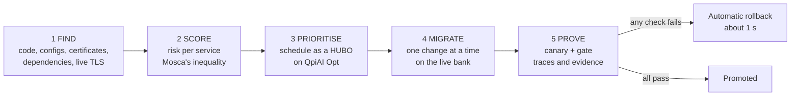

## Highlights

**Find**
- Hybrid detector: rules + ML classifier + cryptographic verification for code and configs; exact parsers for certificates, dependency files and live TLS handshakes. Every finding has file or endpoint evidence, a severity and a banking context.
- Trained and tested on 11 real bank and fintech repositories, with leave-one-repo-out validation.

**Prioritise**
- Risk score per service from Mosca's inequality, with editable assumptions.
- A schedule of 37 tasks over 4 change windows solved natively on **QpiAI Opt** as a HUBO (dependencies, capacity, a month-end freeze, and four cubic "blast radius" rules), checked against an exact CP-SAT solver and a greedy baseline.
- **QpiAI QCloud** circuits: a QRNG circuit supplies entropy for the new keys, and a QAOA circuit cross-checks the schedule.

**Migrate safely**
- Hybrid X25519 + HQC-1 key exchange, FN-DSA-512 certificates and tokens, an SLH-DSA root CA and settlement signatures, one task at a time through graceful nginx reloads.
- A fast canary and a 69-check gate decide each change; a bad change is rolled back in about a second, automatically or by hand.
- Manual controls: apply, apply with prerequisites, force (to show why order matters), apply several together, run a wave, fault drill, gate on demand, rollback, reset, and real handshake probes.

**Never lose a payment**
- A payment is stored first and settled in the background; a payment shown as failed can never post later; NetBank shows a clear red **payment failed** screen with *Try again* and *New payment*.

**Prove and tell people**
- Before/after TLS traces, compatibility and attack tests, overhead benchmarks, a Proof page with a card per change, and a security-admin dashboard.
- **Email (Mailgun):** a PDF scan report to the bank admin, and a critical alert sent only if the customer path is actually broken.

## PQBank: the bank we migrate

PQBank is a working mini-bank, not a mock. Customers sign in with a password, get OAuth2 tokens, see balances, and send money; a double-entry ledger keeps a signed, hash-chained audit trail; a KMS holds every signing key; a settlement job sends signed batch files to an external clearing house. Eleven containers run it: eight bank services, the clearing house, a legacy customer app and a toolbox.

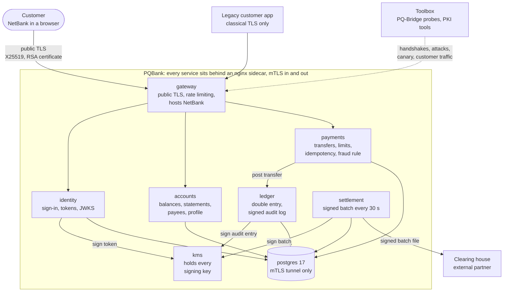

| Service | What it really does | Crypto it uses (what we migrate) |
|---|---|---|
| **gateway** | Public TLS for customers, rate limiting, routing, security headers, serves NetBank | Public TLS (RSA certificate, X25519); mTLS to the services behind it |
| **identity** | Customer login (scrypt password hashes, 60 s lockout after 5 failures), OAuth2 access tokens (5 min) and rotating refresh tokens (1 day), JWKS | Token signature (made by the KMS); mTLS |
| **accounts** | Balances, statements with running balance, payees with name enquiry, profile, password change; needs a token with the right scope | Token verification via JWKS; mTLS; DB TLS |
| **payments** | Transfers with scope and ownership checks, a required Idempotency-Key, limits (₹50,000 per transfer, ₹2,00,000 per day), a fraud rule (a large first payment to a new payee is held for review) | Token verification; mTLS; DB TLS |
| **ledger** | Double-entry posting in one database transaction (no overdraft), each posting adds a **hash-chained audit entry signed by the KMS**; entries remember the algorithm that signed them, so old ones stay verifiable after a migration | Audit signature (via KMS); mTLS; DB TLS |
| **kms** | The only process that can read signing keys. It signs only for the service authorised for that purpose: identity for tokens, ledger for audit, settlement for batches | Its own keys (RSA now, FN-DSA and SLH-DSA after migration); mTLS |
| **settlement** | Every 30 s builds a batch file of newly posted transfers, has the KMS sign it, sends it to the clearing house, and retries rejected batches | Batch signature; mTLS to the partner |
| **postgres** | PostgreSQL 17, reachable only through an nginx stream tunnel with mTLS | DB TLS |
| **clearing house** | An external partner: accepts a batch only if it verifies with a bank key it has been given, so a bank cannot migrate its signature without the partner trusting the new key first | Trust in the bank's settlement key |
| **legacy app** | A customer app built before PQC: classical TLS only, trusts only the RSA root, checks the gateway every second | Classical TLS |
| **toolbox** | Issues certificates and keys; runs the gate's real handshakes, attacks, business checks and the simulated customer | N/A |

**How the bank is built so it can be migrated.** Applications listen only on localhost; each has an **nginx sidecar** that terminates mTLS and calls other services through a local mTLS egress, and SQL goes through an nginx stream tunnel. No application holds TLS keys or picks TLS algorithms. All TLS settings live in one rendered nginx config per service, and the few application-level choices (token, audit and settlement signature algorithms) come from a small state file read on every request. That is what lets a migration change one thing at a time without restarting services.

**What a payment does inside the bank:**

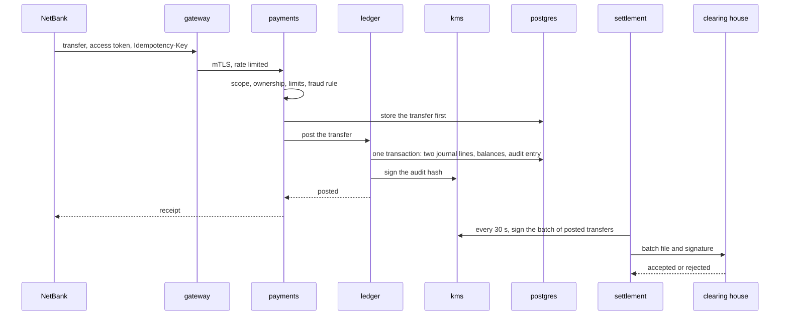

**Bank-wide integrity checks** (used by the gate and the dashboard): money is conserved, the journal balances, the audit hash chain verifies with signatures, and the settlement batch is accepted by the clearing house.

## NetBank: the customer app

A real internet-banking web app (no build step) served by the gateway at `https://localhost:8443/`. Everything the migration changes sits underneath it, so it is the visible proof that customers are unaffected.

| Page | Features |
|---|---|
| Sign in | Username and password, lockout after 5 failures, silent token refresh, sign-out after 10 minutes idle |
| Overview | Total and per-account balances, recent activity, last sign-in |
| Statement | Per-account history with running balance, date and in/out filters, CSV download, held and declined payments |
| Pay and transfer | Own accounts, saved payees or any account number; name check; review step; one Idempotency-Key per reviewed payment so a retry can never pay twice; receipt with reference; limits shown; a **payment failed** screen with *Try again*, *New payment* and *View statement* |
| Payees | Add (verified by name enquiry), pay, remove |
| Profile | Edit contact details, change password (signs every session out), and the signature algorithm of your current session, which flips to FN-DSA-512 after the token-signer migration without signing you out |

The gateway sets a strict Content-Security-Policy, `X-Frame-Options` and `nosniff`; user text is escaped and CSV export neutralises spreadsheet formulas. Demo customers are listed in [netbank/README.md](netbank/README.md). The public certificate stays RSA until customer devices can verify FN-DSA, so this app also shows why that one migration task is deferred.

## How a migration changes the bank

- A **task** edits the bank's crypto state (key exchange, certificate, trust store, token algorithms) and, for PKI tasks, issues keys and certificates in the toolbox.
- The nginx config of each changed service is re-rendered, checked with `nginx -t`, then **gracefully reloaded**, so in-flight connections finish and nothing drops. If the check fails (for example a certificate that does not exist yet) the running bank is never touched and the files are restored.
- **KMS tasks** create FN-DSA and SLH-DSA keys *inside* the KMS, so no service ever sees them. **Partner tasks** hand the clearing house the new settlement public key (a key ceremony with a partner).
- Keys for the new PKI are seeded with randomness from a **QpiAI QCloud QRNG circuit**, mixed with the operating system's random generator.
- **Rollback** writes the previous state back and reloads the same services. Every change is recorded, and *Rollback last change* undoes them one at a time.

## PQ-Bridge architecture

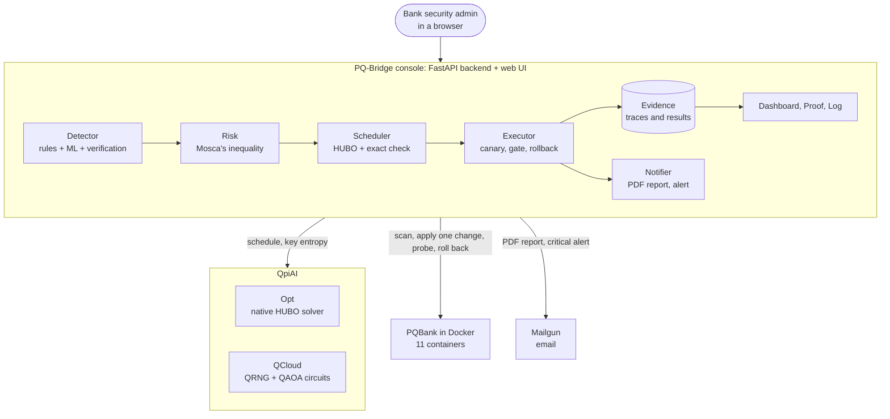

| Layer | Technology |
|---|---|
| Console backend | Python, FastAPI, uvicorn |
| Web UI | JavaScript, HTML, CSS, no framework |
| Detection and ML | scikit-learn (neural network, TF-IDF), NumPy, pandas, joblib |
| Scheduling | QpiAI Opt (native HUBO), OR-Tools CP-SAT as the exact baseline |
| Quantum circuits | QpiAI Quantum SDK and QCloud (QRNG, QAOA) |
| The bank | Docker, Alpine, nginx sidecars for mTLS, PostgreSQL 17, Python services |
| Cryptography | OpenSSL 3.5, liboqs 0.16, oqs-provider 0.12 |
| Email | Mailgun API, ReportLab for the PDF |

## Detection engine and the ML model

Every candidate line gets a decision from three independent sources, which are then fused:

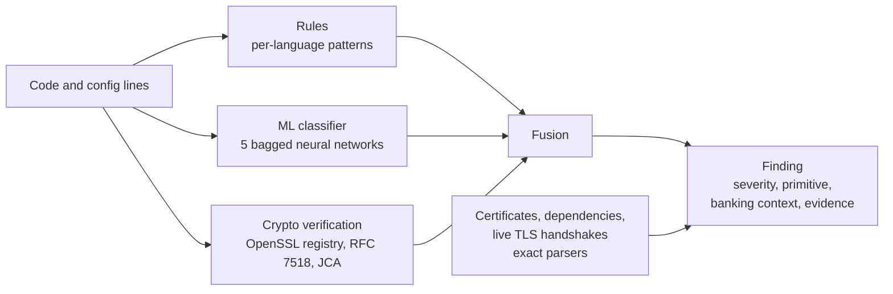


**The data.** We cloned 11 public bank and fintech repositories at pinned commits: Apache Fineract, AWS Payment Cryptography samples, Consensys Quorum and Tessera, Goldman Sachs gs-quant, Hyperledger Fabric, JPMorgan Fusion, Juspay Hyperswitch, Moov ACH and ISO 8583, and OpenBankProject. They contain **1,077** cryptographic usage sites, of which 1,067 resolve to a known algorithm. From 9 of them we hand-labelled **571 lines (297 positive)** to train and test the classifier. The repositories are training and validation data only; the engine then scans PQBank.

**The test.** Leave-one-repo-out: train on 8 repositories, test on the 9th, repeat for all 9. The model is always scored on code it has never seen.

| Method | Precision | Recall | F1 |
|---|---|---|---|
| Rules only | 0.959 | 0.859 | 0.906 |
| ML classifier only | 0.850 | 0.744 | 0.794 |
| Crypto verification only | 0.855 | 0.953 | 0.901 |
| **Fused, balanced mode** | **0.934** | **0.912** | **0.923** |
| Fused, audit mode (high recall) | 0.873 | 0.970 | 0.919 |

Fusion rule: a rule hit is kept unless the model says no (probability under 0.1) *and* nothing verifies; a line no rule caught is added only if the model is confident (0.5, or 0.2 in audit mode) *and* an algorithm verifies. Each finding also carries a severity (for example RSA-1024 is critical, test code is lower), the primitive, and a banking context (payments and cards, open banking, ledger and blockchain, settlement, transport TLS).

| ML model tried (same folds, ML alone) | F1 |
|---|---|
| Gradient boosting | 0.621 |
| Linear SVM | 0.715 |
| Logistic regression | 0.723 |
| Extra trees | 0.761 |
| **Neural network (chosen)** | **0.794** |

**On PQBank itself.** The same engine scans the bank's code and rendered nginx configs, parses its X.509 certificates and keys (FN-DSA and SLH-DSA recognised), and makes one real TLS handshake to each service. On PQBank's own labelled test files (12 files, 27 vulnerable lines) it reaches **precision 0.87 and recall 0.96**, against 0.50 and 0.74 for a plain keyword search. A fresh classical bank scans to about 77 quantum-vulnerable items; after a few migrations the endpoint findings flip to PQ-safe and the count falls.

## Risk and the migration schedule

**Risk.** Each service's score (0 to 10) is `10 × urgency × exposure × criticality`, plus 3% per vulnerable finding. Urgency is *(how long the data must stay secret + how long migration takes) ÷ years until a quantum computer*, capped at 1. Internet-facing services weigh more than internal ones. The assumptions are editable on the Risk page; for example, setting the quantum horizon to 4 years makes identity "at risk" and reorders the plan.

**The 37 migration tasks**, derived from the bank's call graph and each with prerequisites:

| Kind | Count | What they do |
|---|---|---|
| Prepare | 16 | Issue the SLH-DSA root CA and FN-DSA certificates; add the root to each service's trust store; create the FN-DSA token and audit keys and the SLH-DSA settlement key in the KMS; hand the clearing house the new key; publish the new key in JWKS; make accounts and payments accept the new tokens |
| Key exchange | 10 | Hybrid X25519 + HQC-1 on all 8 services; PQ-only HQC-1 on postgres and kms (internal links) |
| Signatures | 11 | FN-DSA mTLS identity on each of the 8 services; identity signs tokens, ledger signs audit entries, settlement signs batches (SLH-DSA) |
| Deferred | 1 | Public gateway certificate to FN-DSA, blocked until customer apps can validate it |

**Schedule.** The tasks go into 4 change windows so that:
- every task comes after its prerequisites;
- no window exceeds its effort capacity;
- the ledger, settlement and database are left alone in the month-end window;
- four risky combinations are never changed together (for example the gateway, payments and ledger certificates), so a failure points to one change.

This is written as a **HUBO** (higher-order binary optimisation) with the combinations as native cubic terms: 148 variables, pruned exactly to 82 with 1,090 terms. **QpiAI Opt** solves it locally from 16 starts and the best feasible plan is kept. A validator checks every rule, and the plan is compared with an exact solver (OR-Tools CP-SAT) and a manual-style greedy plan: our latest plan has no rule violations and lands within about 5 to 10% of the exact optimum (it varies between runs), while the greedy plan breaks a combination rule. Exposure falls window by window and reaches 0% after the last one.

| QpiAI product | What it does here |
|---|---|
| **Opt** | Solves the migration schedule as a HUBO with native cubic terms |
| **QCloud: QAOA** | A 6-qubit, 2-layer circuit re-solves the hardest 3-task cluster (the settlement-signer rollout); it finds the brute-force optimum, with about 3× the probability of random guessing |
| **QCloud: QRNG** | A Hadamard circuit supplies entropy for the new keys, with randomness health checks (monobit and chi-square); a failed sample is discarded and redrawn |

Circuits are built gate by gate with the QpiAI Quantum SDK, with diagrams and OpenQASM 2.0 export.

## Safe migration

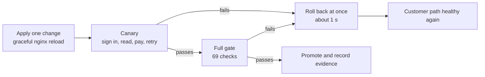

| Gate category | What it checks |
|---|---|
| **Protocol traces** (9) | A real TLS handshake to every node, including postgres and the clearing house: key exchange group, signature, certificate chain |
| **Compatibility** (10) | A classical-only client and the legacy customer app still work |
| **Business flow** (9) | Login issues the right token type, JWKS publishes the right keys, a transfer posts with a signed audit entry, a retry with the same key is a replay, money is conserved, the journal balances, the audit chain verifies, the settlement batch is accepted |
| **Negative tests** (about 25) | Forged, `alg=none`, expired and foreign-issuer tokens; a token without payment scope; wrong password; paying from someone else's account; no Idempotency-Key; overdraft; an unauthorised service asking the KMS to sign or posting to the ledger; no client certificate or a rogue one on every internal service; a classical client against a PQ-only node |
| **Overhead** (9) | Handshake p95 under 50 ms per node |
| **Canary** (5) | Right after the reload: sign in, read accounts and limits, pay one paisa, retry it. If this fails the change is rolled back at once |
| **Availability** (2) | A simulated customer and real NetBank users lose nothing during the change |

**Operator controls** (Migrate page):
- **Apply** one task; refused up front if prerequisites are missing, naming the chain that would fix it.
- **Apply + prerequisites**: applies every missing prerequisite first, in order, each as its own gated change.
- **Force**: applies anyway, to show why order matters. Certificate tasks without the PQ PKI are refused by the pre-reload check; order mistakes in key exchange or tokens break real traffic and the gate rolls them back.
- **Apply selected together**, **Run wave N** (a whole window from the plan), **Fault drill** (the public-certificate scenario).
- **Auto-rollback** toggle: off keeps a failed change in place so you can show the damage, then **Rollback last change** by hand.
- **Run verification gate now** on the current state, **modern / classical client** probes with a full `openssl s_client -trace`, and **Reset bank to classical**.

**Payments survive a bad change.** NetBank retries with the same idempotency key for up to 20 seconds. The payments service stores a transfer first and keeps retrying the ledger for about 12 seconds; if it still cannot post, the payment fails cleanly under the ledger's audit lock, and the ledger refuses to post a failed transfer, so a payment the customer was told failed can never move money later.

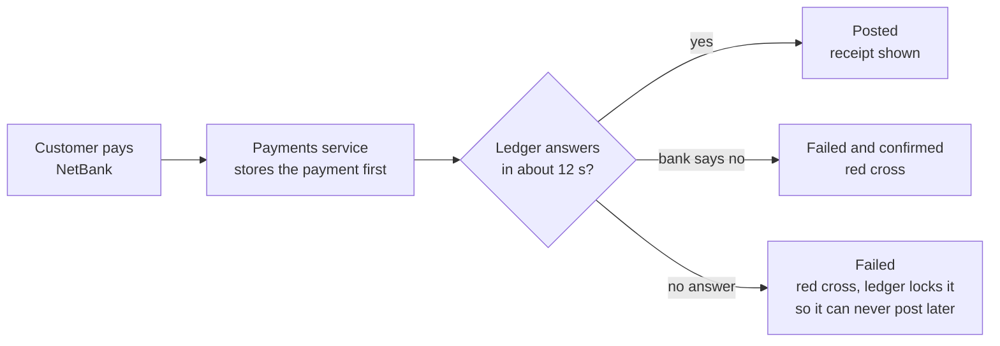

## Email notifications

Set up in `.env` (Mailgun settings, and for each bank its name, admin name and admin addresses), then use the buttons in the console:

- **Email report** (Scan page): a PDF with the summary, severity counts, services ranked by risk, every vulnerable finding, and the recommended fix order.
- **Email alert** (Migrate page): checks the customer path right now and sends a **critical** email only if it is broken, for example after a forced change was left in place with auto-rollback off. The email says what happened, which prerequisites are missing, what is failing, the customer impact, and the steps to recover.

Several banks can be configured in `.env`; each gets its own recipients. The scan data itself currently covers PQBank only.

## The console

<table>
  <tr>
    <td width="50%">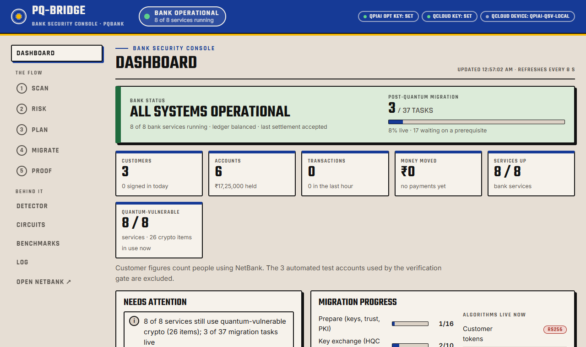<br><sub><b>Dashboard:</b> bank status, services, algorithms live now, migration progress</sub></td>
    <td width="50%">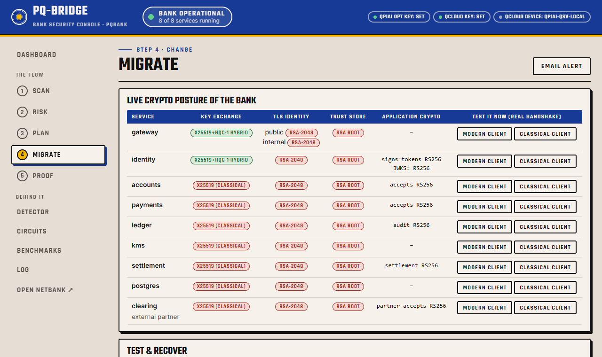<br><sub><b>Migrate:</b> live crypto posture, apply, gate, rollback, test with real handshakes</sub></td>
  </tr>
  <tr>
    <td width="50%">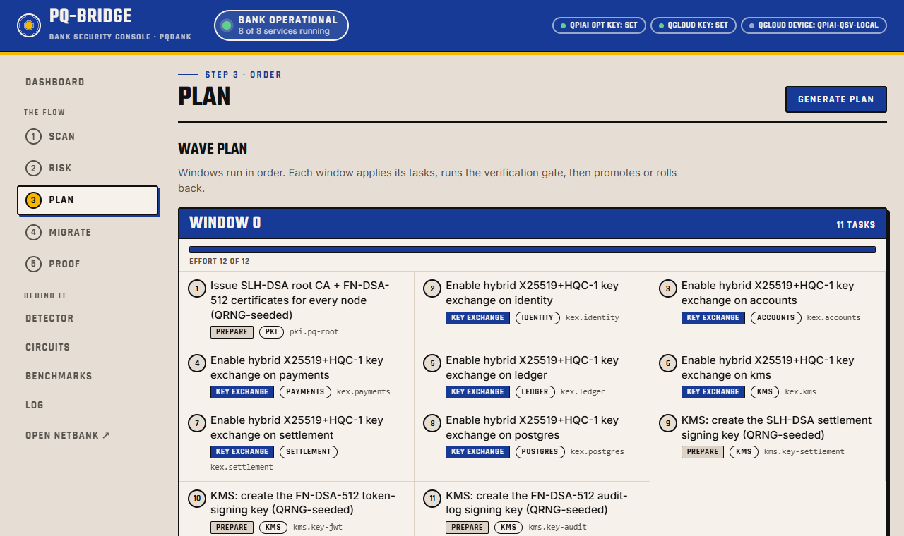<br><sub><b>Plan:</b> the schedule across change windows, with effort per window</sub></td>
    <td width="50%">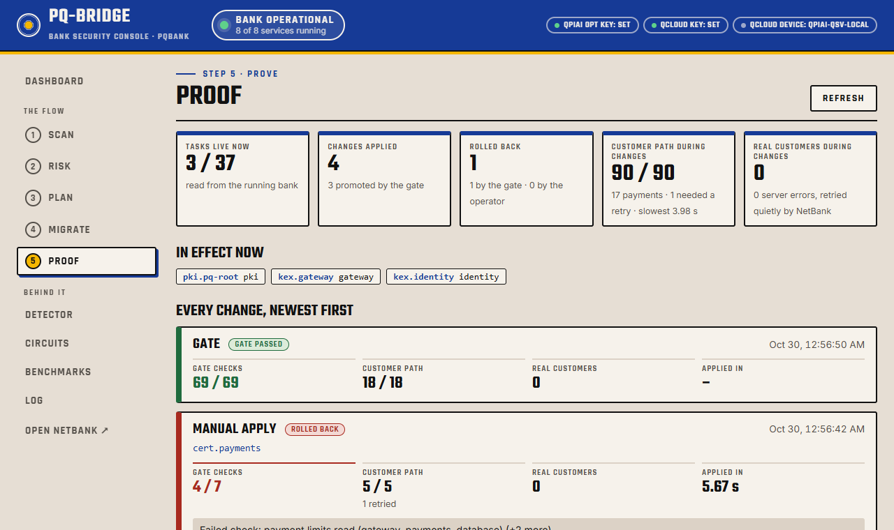<br><sub><b>Proof:</b> one card per change: gate checks, customer path, outcome</sub></td>
  </tr>
</table>

| Page | What it shows |
|---|---|
| **Dashboard** | A security-admin view of the whole bank: overall status, containers, customers, accounts, transactions, money moved, algorithms in use, migration progress, and alerts (a container down, ledger integrity broken, last change failed, payments held for review, locked accounts, services still quantum-vulnerable). Buttons to verify the audit chain, run the gate, scan and reset |
| **Scan** | Every quantum-vulnerable item with its evidence, filters by status and category, **Scan bank** and **Email report** |
| **Risk** | Risk score per service and the assumptions behind it, which you can edit and re-score |
| **Plan** | **Generate plan**, the schedule window by window (the month-end freeze is marked), and how exposure falls as windows complete |
| **Migrate** | Live crypto posture per service, the 37 tasks with status (applied, ready, blocked), all operator controls above, real handshake probes, activity history, **Email alert** |
| **Proof** | A card for every change: gate result, customer path during the change, time to apply, outcome; tiles for tasks live, changes, rollbacks and real customers' errors |
| **Detector** | How rules, ML and verification combine, accuracy on unseen repositories, findings per repository, and **Re-validate** (2 to 9 minutes) |
| **Circuits** | The QpiAI QCloud QRNG and QAOA circuits, with diagrams, run results and OpenQASM download |
| **Benchmarks** | Cost of classical vs hybrid vs PQ-only mTLS, and the size and time of the new signatures |
| **Log** | Colour-coded run log of everything the console did |
| **NetBank** | The customer web app at `https://localhost:8443` |

## Results at a glance

| Area | Result |
|---|---|
| Detection | Fused F1 0.923 on unseen repositories; 0.87 precision and 0.96 recall on PQBank's test files |
| Schedule | 37 tasks, 4 windows, 0 violations, within about 5 to 10% of the exact optimum |
| Migration speed | About 7 to 10 s per change including the full gate; rollback about 1 s; plan about 10 s; reset about 10 s |
| End-to-end test | 28 live checks pass: no payment lost or paid twice, failed payments never post, books balance, audit chain verifies |
| TLS cost | Classical 3.9 KB and 3 ms per handshake; hybrid 35.3 KB and 61 ms; PQ-only 37.9 KB and 61 ms |
| Signatures | RS256 256 B; FN-DSA-512 652 B at a similar sign time; SLH-DSA 7,856 B and 429 ms to sign (fine for one batch every 30 s, not per request) |
| Industry survey | Of 24 public bank and fintech sites, 21 already use ML-KEM hybrid key exchange; none use HQC or post-quantum certificates |

Benchmarks use PQBank's own sidecar mTLS settings, certificate recipe and signing code on isolated listeners, measured on a laptop running Docker Desktop, not bank hardware.

## Post-quantum suite

| Role | Algorithm |
|---|---|
| TLS key exchange | **HQC-1**: hybrid `x25519_hqc1`, or PQ-only `hqc1` |
| Leaf certificates and signed tokens | **FN-DSA-512** (Falcon) |
| Root CA and settlement files | **SLH-DSA-SHA2-128s** (FIPS 205) |

Built on OpenSSL 3.5, liboqs 0.16 and oqs-provider 0.12. ML-KEM and ML-DSA are deliberately not used in the bank; the survey above only measures how widely ML-KEM is deployed.

## Run it

**You need:** Docker Desktop (running), Python 3.11 to 3.13, git, internet, and free ports 8000 and 8443. About 6 GB of disk. Clone outside OneDrive or other synced folders; they slow the analysis a lot.

```powershell
git clone https://github.com/Jeevannyk/pq-bridge.git ; cd pq-bridge
python -m venv .venv
.venv\Scripts\pip install -r requirements.txt
copy .env.example .env          # add QPIAI_OPT_API_KEY and QCLOUD_API_KEY
.venv\Scripts\python run_all.py # builds the bank and runs the whole pipeline, 15 to 25 min the first time
.\dev.ps1                       # console at http://127.0.0.1:8000
```

On Linux or macOS use `.venv/bin/python` and `.venv/bin/uvicorn pqbridge.api:app --reload --reload-dir pqbridge`. Free keys: [opt.qpiai.tech](https://opt.qpiai.tech) and [qcloud.qpiai.tech](https://qcloud.qpiai.tech). Before a demo, click **Reset bank to classical** on the Migrate page. The ML model (about 170 MB) is not stored in git; it is trained from the labels on first use, which takes about half a minute.

**What `run_all.py` does:** fetches the 11 real repositories at pinned commits; builds the Docker image (compiles liboqs and oqs-provider) and starts the classical bank; scans the bank; trains and validates the ML engine; surveys 24 public TLS endpoints; scores risk and solves the plan; runs the QCloud circuits; applies the 4 migration waves and the fault drill; runs the benchmarks; writes the report.

**Email is optional.** Set `MAILGUN_API_KEY`, `MAILGUN_DOMAIN` and, per bank, `BANK_<ID>_NAME`, `BANK_<ID>_ADMIN_NAME` and `BANK_<ID>_ADMIN_EMAILS` in `.env` (see `.env.example`), then restart the console. A Mailgun sandbox domain only delivers to addresses you have authorised in the Mailgun dashboard.

**Test it.** With the bank running, `python tests/live_payments.py` replays a customer paying through a good migration, a bad one rolled back by the gate, and bad ones left in place until the operator rolls them back. It checks that no payment is lost or paid twice, that a payment shown as failed never posts later, and that the books balance and the audit chain verifies.

**Drive it without the UI.** Everything the console does is an HTTP call on `http://127.0.0.1:8000`: `/api/tasks`, `/api/apply`, `/api/rollback`, `/api/gate`, `/api/probe/<service>`, `/api/plan`, `/api/scan`, `/api/analyse` (paste code, get findings), `/api/dashboard`, `/api/audit/verify`, `/api/reset`, `/api/notify` and `/api/notify/alert`.

**Troubleshooting:** if every number shows a dash, Docker is not running or the bank is down (reset the bank or rerun `run_all.py`). Only one operation runs at a time; the sidebar shows what is running. If the plan says Opt was not used, the key is missing from `.env`.


## Repository

| Folder | Contents |
|---|---|
| `pqbridge/` | Console backend: scan and detector, risk, schedule, migrate and gate, benchmarks, dashboard, email |
| `console/` | The web UI |
| `testbed/` | PQBank: Dockerfile, compose file, the bank's services, probes |
| `netbank/` | The customer web app |
| `tests/` | The live end-to-end payments and migration test |
| `corpus/`, `data/` | Labelled test code, training labels, and the pinned list of real repositories |
| `evidence/` | Every recorded result (generated): inventory, plan, traces, benchmarks, circuits, report |
